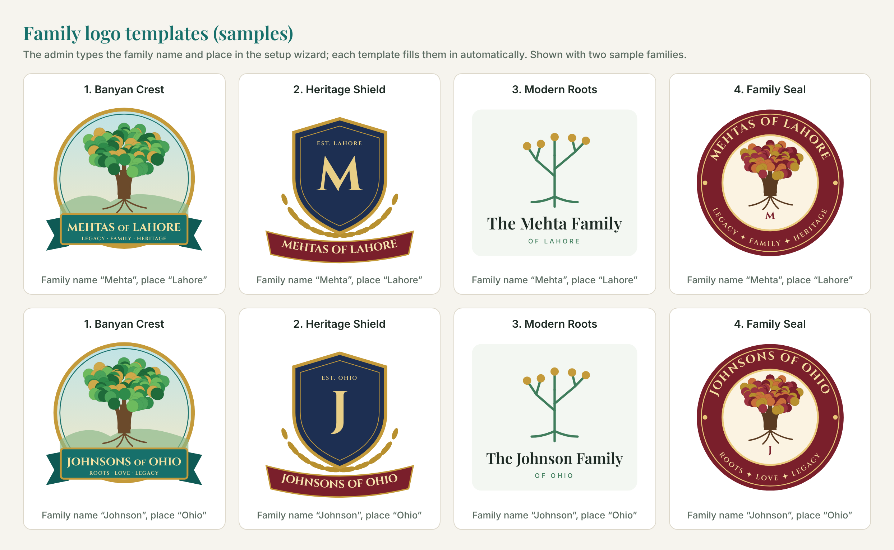

# Family Tree Product: Requirements

**Status:** agreed plan, 20 November 2026. Sunil approved the plan as written on 20 Nov 2026. Nothing here is built yet. The only open item is the brand name (section 11).

This document plans how the Jaggis of Chakwal family tree becomes a product that **any family** can sign up for, set up on their own, and use, with no technical help. The Jaggi site (https://familytree.sjaggi.com) keeps working exactly as it does today and becomes the product's first family ("tenant #1").

The requirements of the Jaggi site itself stay in [`REQUIREMENTS.md`](REQUIREMENTS.md). This document reuses everything described there and only lists what changes or is added for the product.

*Working name:* until a brand is chosen, this document calls the product **"the product"** and a family's tree **"a family site"**.

---

## 1. Goal

Turn the family tree into a product that:

1. Anyone can start in a few minutes: sign up, name their family, pick a look, add the first people, invite relatives by email.
2. Contains nothing about the Jaggi family unless the family is the Jaggi family: no Jaggi logo, names, badges, Help text, emails or seed data.
3. Is easy for people who are not technical at all, both the person who starts the tree (the family admin) and the relatives they invite.
4. Works on any phone or computer, and later from the App Store and Google Play.
5. Earns money in a way families find fair, without charging the relatives who are invited.

## 2. What exists today, and what is Jaggi-specific

The current site is about 6,000 lines of plain JavaScript plus a Supabase database. Almost all of it is general family-tree work that every family needs. The Jaggi-specific parts are few and well contained:

| Area | What is Jaggi-specific today | What the product needs instead |
|---|---|---|
| Name and logo | "Jaggis of Chakwal", the Jaggis logo images, page titles, Google site name | Family name, tagline and logo chosen in setup; a simple monogram logo is made automatically if they have none |
| Colours | Banyan teal and gold | A few colour themes to pick from, plus a custom main colour |
| Footer | "© 2026 Jaggi Family and Quantum Nexus LLC", Quantum Nexus mark | "© &lt;year&gt; &lt;family name&gt;" plus a small "Made with &lt;product&gt;" link |
| Help manual | Written about the Jaggi family, with Jaggi screenshots | One general manual for all families, showing the family's own name, with neutral sample screenshots |
| Founder and Creator badges | Hard-coded for Suraj and Sunil by account id | Admin can create their own special badges and give them to anyone |
| Blessings | Generation 1 named as Bakhshi Bhanna Mal Jaggi; fixed point values | Root ancestor's name filled in automatically; admin can turn Blessings on or off and adjust points |
| Branches | Branches start at Generation 4 (fixed in code and database) | Admin picks the branch level in settings (default: the root's grandchildren) |
| Welcome texts | "Welcome dear member of Jaggi Family!", invite wording, reminder wording | Wording uses the family name; the admin can edit invite and reminder texts |
| Library | Topics such as "Chakwal history", "Partition 1947", "Arya High School" | Starts with general topics (Family history, Places, Old photos, Other); admin adds their own |
| Seed data | 70 people from the two Jaggi PDFs | Every new family starts empty (or from a GEDCOM file they bring) |
| Ancestors pages | Built for one site, one domain | Built per family, only if the family turns them on (off by default) |
| Emails | Sent from the family Gmail account, "Jaggi family tree" as sender name | Sent by the product's email service, with the family name as sender name and replies going to the family admin |
| Addresses | familytree.sjaggi.com hard-coded in the email functions | Each family's own address |
| Visitor counter | GoatCounter code "jaggis-chakwal" | One counter for the product; each family sees only its own numbers |
| GEDCOM export | Source "JAGGI_FAMILY_TREE", file name jaggi-family-tree | Product name and family name |

**Conclusion:** the work is not a rewrite. It is (a) moving these items into **settings** each family controls, (b) letting one database hold **many families** safely, and (c) adding **sign-up, a setup wizard and billing**.

## 3. Build options

### 3.1 How families are hosted

| Option | What it means | Good | Not so good |
|---|---|---|---|
| **A. One shared platform (multi-tenant)** *(recommended)* | One website and one database. Every row of data carries the family it belongs to, and the database's security rules keep families apart (the same kind of rules that already keep "Family branch only" details private). Each family gets its own address, such as `smith.<product>.com`. | One thing to run, fix and improve; a new family is ready in seconds with no setup by us; cheapest to run; easiest for non-technical families | Security rules must be right (a mistake could show one family's data to another), so this needs strong automatic tests, which the project already has |
| B. A separate copy per family | Each family gets its own database and website copy | Families are completely apart | Every family needs setup by hand; every fix must be applied hundreds of times; Supabase's free plan allows only 2 projects, paid ones cost about $25 a month each, which is more than a family would pay |
| C. Self-host | Families download the code and run it themselves | Families own everything | Only technical people can do it, which is the opposite of who the product is for |

**Recommendation: A.** Offer C later, only if there is demand, as an "export everything" feature (GEDCOM + photos in a zip) rather than as self-hosting, so families never feel locked in.

### 3.2 Phone apps

| Option | What it means | Recommendation |
|---|---|---|
| **Web app + "Add to Home Screen" (PWA)** | The same website installs like an app on phones, with its own icon, and opens full screen | **First.** No app store approval, no store fees, one code base. |
| **Store apps from the same code** (Capacitor) | The website is wrapped into real App Store and Google Play apps | **Second**, once the product has paying families. Costs about $99 a year (Apple) and $25 once (Google). Apple takes 15% of payments made inside an iPhone app, so subscriptions are sold on the website. |
| Separate native apps | iPhone and Android apps written from scratch | Not recommended: two more code bases to keep in step. |

### 3.3 Technical changes (plain summary)

- **Families in the database:** a new `families` table (name, address, logo, colours, settings, plan). Every existing table gets a `family_id`. Every security rule also checks the family. The Jaggi data becomes family #1 with no change visible to Jaggi members.
- **Membership per family:** a person can belong to more than one family site with one login (for example, someone in both their own and their spouse's family tree). Roles (admin, branch admin, member) are per family.
- **Website hosting:** move from GitHub Pages to a host that handles many addresses and custom domains (Cloudflare Pages is free and supports this; Netlify and Vercel are similar). familytree.sjaggi.com keeps working.
- **Email:** Gmail cannot be used to send a product's emails. Use an email service such as Resend or Postmark (free for small volumes, then about $20 a month), sending from the product's own domain.
- **Payments:** Stripe (no monthly fee; about 3% per payment). Stripe handles cards, receipts and cancellations.
- **Supabase plan:** move to Supabase Pro (about $25 a month) before the first paying family, for daily backups and no pausing. One project serves all families.
- **Code repository:** the current repository is **public**, which means anyone on the internet can read and copy all of the site's code (not the family's data, which lives in Supabase and is protected). That was fine for one family's site. For a product that earns money, the code is the business, so it should live in a **private** repository: only Sunil (and anyone he invites) can see it. Websites run the same way from a private repository; GitHub's free plan allows private repositories. **Agreed (Sunil, 20 Nov 2026):** the product is built in a new private repository; the Jaggi repository stays as it is.

## 4. Commercial options

### 4.1 What others charge (approximate, late 2026; to be checked before pricing)

| Product | Focus | Price |
|---|---|---|
| FamilySearch | One shared world tree, run by a church | Free |
| Ancestry | Historical records and DNA; trees free | Records about $25 to $60 a month |
| MyHeritage | Records, DNA, family sites | Free up to 250 people; about $130 to $300 a year for bigger sites and records |
| Geni | One shared world tree | Free; Pro about $120 a year |
| TribalPages and similar | Private family website with a tree | Free small sites; about $30 to $100 a year |

**Where this product fits:** the big names sell **record searching and DNA**. Few offer what this site already does well: a **private, beautiful, family-run site** where relatives fill in their own branches, with approvals, branch admins, privacy per detail, stories, a library, Blessings to keep people adding, and a printed family book. **Audience: everyone from day one** (Sunil, 20 Nov 2026). The product is for any family, in any country. Families of the South Asian diaspora, where oral history is strong and records are scarce, are one good group to reach early, through Sunil's own network and the pilot families.

### 4.2 Ways to charge

| Model | How it works | Comment |
|---|---|---|
| **Freemium, priced per family** *(recommended)* | Free plan for small trees; one yearly price per family for the full product. **Invited relatives never pay.** | Lets families try without risk; one decision-maker pays; relatives join freely, which grows the product |
| Price per member | Each member pays | Puts off the relatives you most need. Not recommended. |
| One-time lifetime purchase | Pay once | Simple for older buyers, but we keep paying hosting forever. Offer later, priced high, if asked for. |
| Printed book upsell | The family orders the coffee table book printed from their tree | High value, ties in with Sunil's own book; added on top of any plan |
| Custom domain add-on | Use their own address (like familytree.sjaggi.com) | Small yearly add-on |

### 4.3 Suggested plans

Sunil (20 Nov 2026): about $49 a year looks right to start with.

| | Free | Family | Heritage |
|---|---|---|---|
| Price | $0 | about $49 a year (or $5 a month) | about $99 a year |
| People in the tree | up to 3 generations or about 50 people (see 4.4) | unlimited | unlimited |
| Photos | up to 100 | up to 5,000 | up to 25,000 |
| Members | unlimited | unlimited | unlimited |
| Logo and colours | colours only | yes | yes |
| Branch admins and approvals | yes | yes | yes |
| Blessings, Library, Dashboard | Dashboard only | yes | yes |
| PDF family book and GEDCOM export | GEDCOM only | yes | yes, plus book design templates |
| Own address (custom domain) | no | add-on | included |
| Remove "Made with &lt;product&gt;" | no | no | yes |
| Help | Help manual | email help | priority help, setup call |

### 4.4 How the free plan ends (agreed 20 Nov 2026)

Sunil suggested free for about 1 month or 3 generations, with paid plans beyond that. Agreed:

- **The Free plan has no time limit.** It stays free while the tree has **up to 3 generations or about 50 people**, whichever comes first. A strict 1-month limit would hurt families, because relatives join and fill in branches slowly, over months.
- **Every new family site gets all features for its first 30 days** (Family plan features: logo, Blessings, Library, PDF book). This is the "1 month" part: families see everything the paid plan offers.
- After 30 days, unless they upgrade, the site keeps working on the Free plan: nothing is deleted or hidden, and members can still look, search and suggest corrections. Only the extra features pause.
- When the tree reaches the free limit (a 4th generation, or about 50 people), the admin is asked to upgrade before adding more. Adding is paused, never deleted. The admin gets a friendly email a week before the trial ends and when the limit is near.
- **Members never pay.** Only the family admin chooses and pays for a plan.

Printed books are ordered separately through a print-on-demand partner (for example Lulu or Blurb, which print and ship hardcover books), with the product adding a margin. How the book service works is in 5.9.

**Recommendation:** freemium per family with a yearly plan, members always free, printed books as the add-on. Start with a **free pilot** for 5 to 10 families Sunil invites (April to May 2027) before charging anyone.

**Agreed:** prices as above to start with. Selling under Quantum Nexus LLC is under consideration (Sunil, 20 Nov 2026).

## 5. Product requirements

### 5.1 Sign-up (no technical knowledge needed)

1. A public home page explains the product with pictures, plans and a **Start your family tree** button.
2. Sign-up asks only for email and the person's name. No password: an emailed code or link, as on the Jaggi site today.
3. Optional sign-in with Google or Apple (one tap) for people who prefer it.
4. The person who signs up becomes the **family admin** of the new family site.

### 5.2 Setup wizard

A friendly step-by-step screen, one question per screen, with **Back**, **Skip for now** and a progress bar. Everything can be changed later in **Family settings**.

1. **Your family's name**, for example "The Mehtas of Lahore". A short tagline is optional.
2. **Your site's address**: suggested from the name (`mehtas-of-lahore.<product>.com`); the person can change it; the wizard says at once if it is taken.
3. **Your logo** (Sunil, 20 Nov 2026): pick one of several **ready-made family logo templates** that fill in the family's own name automatically, just as the Jaggi logo says "Jaggis of Chakwal". The wizard already knows the family name and place from step 1, so every template is shown with their name in it straight away; they tap the one they like. Or they can upload their own logo. Details in 5.2.1.
4. **Your colours**: pick one of 6 to 8 ready-made themes (with a live preview of the tree), or choose a main colour. Light and dark work automatically.
5. **Who is at the top of your tree?** Two choices: "Start with me" (they add themselves, then parents and grandparents) or "Start with our earliest ancestor" (they type that ancestor's name).
6. **Privacy**: one simple choice, with a plain explanation:
   - *Private family site* (default): only invited members see anything.
   - *Names public, details private*: like the Jaggi site today.
7. **Bring an existing tree** (optional): upload a GEDCOM file from Ancestry, MyHeritage, FamilySearch and others. *Later:* upload a photo or PDF of a hand-drawn tree and the product reads it and suggests the people (this is how the Jaggi tree was started).
8. **Add your first people**: a quick form for parents, spouse, children and siblings, all on one screen.
9. **Invite your family**: type names and emails (or paste a list); for each invitee, optionally pick their box in the tree so they land on it. WhatsApp and Copy message buttons as today.
10. **Done**: the tree opens, with a **Getting started checklist** on the Dashboard (add a photo, add 10 people, invite 3 relatives, make your first branch admin).

The whole wizard should take **under 10 minutes**.

#### 5.2.1 Family logo templates (agreed 20 Nov 2026, designs to be finalised)

- At launch, **4 to 6 templates** in different styles, for example a **Banyan Crest** (tree in a circle with a ribbon, like the Jaggi logo), a **Heritage Shield** (shield with the family's first initial and laurels), **Modern Roots** (simple line tree and clean lettering) and a **Family Seal** (round seal with the name around the edge).
- The admin types: **family name** (for example "Mehta"), **place** the family comes from (optional, for example "Lahore"), and an optional **motto** (for example "Legacy · Family · Heritage"). The product builds the wording, such as "Mehtas of Lahore" or "The Mehta Family of Lahore", and the admin can edit the exact wording (for names where adding "s" is wrong, or for "The Mehta-Kapoor Family").
- Long names shrink to fit automatically; the first letter of the family name is used where a template has an initial.
- Each template comes in the family's chosen colours (wizard step 4), or in its own colours.
- The finished logo is used everywhere the Jaggi logo is used today: the site header (with hover or tap to enlarge), the sign-in page, emails, the PDF family book cover and page headers, and the printed book (5.9). It is made as a sharp vector image, so it prints cleanly at any size.
- The admin can change the template or wording any time in Family settings, or upload their own logo instead.
- Hindi, Punjabi and other scripts for names can follow later (5.8).

Sample mock-ups with two made-up families (final designs would be drawn by a designer or refined later; these show the idea):

### 5.3 Family settings (admin)

Everything the wizard asked, plus:

- **Branding:** name, tagline, logo (change template or wording, or upload their own; see 5.2.1), favicon (made from the logo automatically), colours, footer text.
- **Address:** subdomain; custom domain (with plain step-by-step instructions and a "check my domain" button).
- **Privacy defaults:** site private or names public; default for new details and photos (Family branch only by default); rules for marriage dates and adoption labels (today's Jaggi rules as defaults).
- **Branches:** which generation branches start at (default: the root's grandchildren), with a preview of the branches this makes.
- **Who can invite:** any member (default) or admins only.
- **Blessings:** on or off; point values; generation multipliers; badges, including **special badges** the admin creates (name, icon, description) and gives to people, such as "Founder of our family tree".
- **Library:** on or off; topics.
- **Public ancestor pages for search engines:** off by default; when on, only for people marked as passed away, with Public details only.
- **Emails:** editable invite and reminder wording, with preview. How emails are sent is in 5.3.1.

#### 5.3.1 Who invitation emails come from (agreed 20 Nov 2026)

Sunil asked (20 Nov 2026) whether invitations use the email of the admin who started the family tree. Agreed:

- Emails are **sent by the product**, from its own address (for example `invites@<brand>.com`). The product never needs the admin's email password, and its emails are set up so Gmail, Outlook and Yahoo trust them and do not put them in spam. Sending "from" the admin's own Gmail or Outlook address is not possible for a website without their password, and mail providers would mark such emails as fake.
- The **sender name is the person who invited them**, for example **"Sunil Jaggi via BanyanKin"**, so the relative recognises who it is from.
- **Reply-to is the inviter's own email address**, so when a relative presses Reply, the answer goes straight to the inviter, not to the product.
- The same rule applies to reminders and Missing details emails sent by an admin. Automatic emails (sign-in codes, receipts) come from the product's name only.
- **Ways to invite, all on the Invite screen:**
  1. **Send invitation** (default): the product emails it as above ("&lt;Inviter&gt; via &lt;Brand&gt;", replies to the inviter).
  2. **Send from my own email** (Sunil asked 20 Nov 2026 for the admin's own, familiar address): opens the inviter's own mail program or Gmail with the invitation already written (to, subject, text and sign-in link); they just press Send. It comes from their own address, so relatives recognise it, and the product never needs their password.
  3. **WhatsApp**: carried over from the Jaggi site, where it works today on phones and on the desktop (Sunil tested 20 Nov 2026); opens WhatsApp with the invitation message and link ready to send.
  4. **Copy link**: copies the invitation message and link to paste into a text message, Facebook, Signal or anywhere else.
- Later option, not planned now: "Sign in with Google to send from your Gmail". It would send from the admin's own Gmail automatically, but Google requires a paid security review for apps that send mail on a user's behalf, so it is left out unless families ask for it.
- Later option (Heritage plan): a family with its own domain can send from its own address (for example `family@smithfamily.com`) after a one-time check of that domain.
- **Admins:** add or remove other admins; transfer ownership of the family site.
- **Plan and billing:** current plan, usage (people, photos), upgrade, invoices, cancel.
- **Export everything / delete family site:** a zip with GEDCOM, photos and stories; deleting needs typing the family name and waits 30 days before it is final.

### 5.4 Everything the Jaggi site does today

Every feature in `REQUIREMENTS.md` sections 4 to 8 becomes available to every family, using the family's settings instead of Jaggi values: tree view (own line, Start tree from, search, hover balloon, compact layout, spouses), person card, suggestions and approvals, branch admins and claiming your box, Review with Undo, Members page, Missing details emails, reminders, View as, Dashboard, PDF family book (with the family's logo), GEDCOM export, Blessings, Library, Help, light and dark.

### 5.5 Help manual

- One manual for all families, written for non-technical readers, using "your family" and the family's name where it appears.
- Neutral screenshots made from a made-up sample family.
- Short "how to" videos for the three main jobs: set up your site, add people, invite relatives.
- A separate **Admin guide** for family admins.
- A help button on every screen opens the right section.

### 5.6 Product owner tools (for Sunil)

- A **product dashboard**: number of families, members, people, photos; sign-ups per week; plans and income; families near their plan limits.
- Look up a family (with their permission) to help them; read-only by default.
- Suspend a family site for abuse; send announcements to family admins.
- The product owner cannot read a family's private details without the family admin turning on "Allow support access".

### 5.7 Privacy, security and legal

- Families' data kept fully apart by database rules, tested automatically on every change (extends today's privacy tests).
- Privacy Policy and Terms of Service pages; cookie-free visitor counts.
- Living people's details private by default; anyone can ask for their own details to be removed.
- Children: no accounts for under-13s; their details are added by family and stay Family branch only.
- Daily backups (Supabase Pro), photo storage backed up too.
- Data stored in the United States at first; EU storage later if needed for European families.

### 5.8 Quality

- Works on current iPhone and Android browsers and desktop Chrome, Safari, Edge and Firefox; installable as a home-screen app.
- A tree of 5,000 people stays smooth on a mid-range phone.
- English first; names accept any script. Hindi and Punjabi screens are a good later step for the first audience.
- Accessible: large tap targets, readable font sizes, works with screen readers.

### 5.9 Printed family book service (agreed 20 Nov 2026)

Sunil asked (20 Nov 2026): can the product build the book automatically from ready-made design templates, with no manual work, and then let families change the text, replace pictures and add or change stories? **Yes.** It works like the photo books from Shutterfly or Mixbook, but filled from the family tree.

**How it works**

1. **Choose a design.** The family admin picks one of several ready-made book templates (for example Classic, Heritage and Modern), a size (for example 8.5x11 inches, 11x8.5 landscape, or a 12x12 coffee-table size) and which part of the tree to include (the whole tree, or one branch from a chosen ancestor).
2. **The book builds itself.** In a minute or so the product lays out the whole book with no manual work: a cover with the family name and logo, a family tree chart, then a page or a two-page spread per person or couple, with their photo, years, places, work and story, in generation order. Long stories flow onto extra pages. People without photos get a tasteful placeholder or a smaller layout.
3. **Make it yours.** An easy page editor in the browser (also on a tablet) lets the family:
   - change any text (titles, captions, stories), with spelling check;
   - replace or add pictures, and move or zoom them inside their frame;
   - add pages for stories, letters, old documents or photo collages;
   - reorder, hide or add people and pages;
   - add a dedication and a foreword.
   Edits stay in the book only; a button offers to copy a corrected story or date back into the tree too.
4. **Check it.** A full preview shows every page as it will print. The product warns about pictures that are too low-resolution to print sharply, text that runs off a page, and empty pages.
5. **Share before ordering (optional).** Other family members can view the draft and leave comments; the admin decides.
6. **Order.** The family chooses hardcover or softcover and the number of copies, sees the price including shipping, and pays. The product makes a print-ready PDF and sends it to a **print-on-demand** partner through that partner's ordering connection (API). The partner prints, binds and ships each copy straight to each address; the family gets tracking emails.
7. **Reorder any time** from the saved book, and a digital PDF copy can be downloaded.

**Print partners** (to be confirmed with each partner before building):

| Partner | Good for | Notes |
|---|---|---|
| **Lulu** | First choice: well-documented ordering API, ships worldwide (including India via partners), no minimum order | Standard sizes up to about 8.5x11 and 11x8.5 hardcover; no 12x12 |
| **Blurb** | Premium photo books and lay-flat pages, 12x12 size | Ordering API for businesses is by arrangement |
| **Peecho** and others | Ordering API, many formats | Compare quality and prices during the pilot |

**Rough cost per copy** (late 2026 list prices, to be confirmed with real quotes): a 100-page full-colour hardcover about 8.5x11 costs about **$35 to $50 to print**, a 12x12 premium photo book about **$80 to $130**, plus shipping of about **$8 to $20** in the US (more abroad). The product adds a margin of, say, 20 to 30% for the design, layout and editor. Example: a family book that costs $40 to print sells for about **$52 plus shipping**. Families pay per order; there is no stock and no upfront cost to the business.

**What it takes to build:** the book templates and automatic layout reuse the "Make the PDF" family book the Jaggi site already has, so the starting point exists. New work: two or three templates, the page editor, print-quality checks, the print partner's ordering connection, and payment through Stripe. About **6 to 8 weeks** of work.

**Pilot on the Jaggi site first** (Sunil, 20 Nov 2026): the book builder is built and tested on the Jaggi family tree before it goes into the product, the same way the rest of the product grew from the Jaggi site.

**When in the product:** after the paid launch (from July 2027, as part of phase 5). The Jaggi coffee table book planned for early 2027 can serve as the model for the first "Heritage" template, so the design work is reused.

### 5.10 AI family helper (agreed 20 Nov 2026)

Sunil said yes (20 Nov 2026) to an AI helper in three layers. It uses the Claude API from Anthropic. **It is being piloted on the Jaggi site first**, the same way as the book service.

**Layer 1: Ask the tree.** A chat box where any signed-in member can ask questions in plain words, for example "How am I related to Kamla?", "Who in the family was born in Chakwal?" or "Tell me about my great-grandfather". It answers **only from the family's own data**: people, relationships, notes and stories, and the Family Library. It does not search the web and does not make things up; when the tree does not hold the answer, it says so. It respects privacy: each member's questions are answered only from what that member is already allowed to see (for example "Family branch only" details stay inside the branch), and visitors who are not signed in cannot use it. Answers name the people's boxes so the member can tap through to check.

**Layer 2: Find more about this person.** A button on a person's card ("Find more about this person"). The helper searches the web, for example old newspapers, Partition and migration records, school and college plaques, obituaries and published family histories. It then writes a short summary with:
- the **sources** (a link for each fact);
- a **confidence level** for each finding (high, medium or low), with the reason, for example "same name, same town and same years" or "same name only";
- facts it could not confirm, shown as open questions.

Findings are **never added to the tree automatically**. They go to the family admin as suggestions (like Library links today); the admin accepts, edits or rejects each one, and accepted facts are recorded under Sources with the link. Research runs only for **people who have passed away**. The button is not shown for living people.

**Layer 3: Fill the gaps.** The helper looks over the tree and points out missing pieces, for example "12 people have no birth year", "Grandfather Ram's parents are not recorded" or "No photo of the Gen 2 brothers". For each gap it suggests who in the family might know (the closest living relatives in that branch) and a question to ask them, or a place to look (records, the Library). These can feed the "Missing details" reminder emails admins already send.

**Privacy rules for the AI helper**
- **Living people's details are never sent for web searches.** Research (layer 2) is only for people who have passed away, and only their name, years, places and family names are used in the search.
- Ask the tree (layer 1) sends only the details the asking member is allowed to see, and only for that question. Nothing is kept by the AI provider for training: under Anthropic's commercial API terms, customer data is not used to train models.
- The Privacy Policy (section 9) says plainly that the AI helper exists, what it sends, and that a family admin can switch it off for the whole family.
- Every AI answer or suggestion is labelled as AI-made.

**Cost** (Claude API list prices, late 2026; to be rechecked when building)
- **Ask the tree:** a fraction of a cent to about **2 cents per question** using a smaller, cheaper Claude model (Sonnet or Haiku), depending on how much of the tree the question needs.
- **Find more about this person:** about **20 to 40 cents per research run** using the strongest model (Opus), plus the web searches (about $10 per 1,000 searches, to be confirmed; a run uses about 5 to 15).
- **Fill the gaps:** a few cents per run; it can run once a week per family.
- **Monthly allowance per plan**, so costs stay predictable: **no AI on the Free plan** (Sunil, 21 Nov 2026): free families see the AI buttons with a small lock and a short "Available on the Family plan" note and a sample answer, so they know what they would get; the **Family plan** about 100 questions and 3 research runs a month, the **Heritage plan** about 300 questions and 10 research runs. Families who want more can buy an extra pack (for example $5 for 15 more research runs). A typical family (about 20 questions and 1 research run a month) costs under $1 a month in AI; a Family plan used to the full allowance every month costs about $3 a month, so the allowance is the safety limit.
- The admin's Family settings page shows how much of this month's allowance is used.

**When in the product:** Ask the tree and Fill the gaps can come with the paid launch (June 2027) if the Jaggi pilot goes well; Find more about this person follows in phase 5. About **3 to 4 weeks** of work, much of it proven in the Jaggi pilot.

## 6. Keeping the Jaggi site working

- The Jaggi site keeps running unchanged on familytree.sjaggi.com while the product is built.
- The product is built in a new private repository started from this code. The Jaggi repository stays as it is until the switch.
- When the product is ready, the Jaggi data moves in as family #1, with the Jaggis logo, banyan colours, Founder and Creator badges (as special badges), Library topics, branch level 4 and current privacy rules all set as **its settings**. Members keep their logins, boxes, blessings and history. familytree.sjaggi.com points at the product.
- The move is done with a full backup and a rollback plan, and only with Sunil's go-ahead.

**Sunil (20 Nov 2026):** test moving the Jaggi site onto the product, as long as it is seamless for the Jaggi family. "Seamless" means:

- Same address (familytree.sjaggi.com), same look, logo, menu and Help wording for the Jaggi family.
- Nobody has to sign up again: the same emails sign in the same way; claimed boxes, roles, blessings, badges, Library links, pending suggestions and history are all kept.
- No visible downtime: the move is rehearsed first on a copy of the Jaggi data on a test address, Sunil and a few relatives try it, and only then does the real address switch over (late evening Arizona time, a few minutes at most).
- If anything is wrong, the address switches straight back to today's site, which stays untouched until the move has run well for a month.

### 6.1 Building before buying a domain (agreed 21 Nov 2026)

Sunil asked (21 Nov 2026) to build the product before buying a domain, using what he already has. **Yes, at no extra cost.**

- **Code:** a new private repository on the same GitHub account (free).
- **Database:** a **second, separate Supabase project** in the existing "Jaggi Organization", for example "family-tree-product". The live Jaggi data stays in its own project and cannot be touched by product work. Supabase's free plan allows two active projects, so this is free. One catch: a free project pauses after about a week with no use. During building it is used daily, and it is unpaused with one click if it does pause.
- **Web address for now:** each family gets its own subdomain of sjaggi.com, for example `smith.sjaggi.com` or `mehta.sjaggi.com` (Sunil, 21 Nov 2026), plus `app.sjaggi.com` for sign-up and the product home page. The email (MX) records are never touched.
  - **How each family address is added:** Cloudflare Pages does not accept a "wildcard" address (`*.sjaggi.com`) for a domain whose DNS stays at Turbify, so each family is added once, in about two minutes: Claude adds `smith.sjaggi.com` to the product in Cloudflare, then Sunil adds one CNAME record at Turbify (name `smith`, pointing to the product's `pages.dev` address), the same kind of step he did for familytree.sjaggi.com. The free plan allows up to 100 family addresses, far more than the 5 to 10 pilot families.
  - **Until a family's record is added**, the family's site already works at `app.sjaggi.com/smith`, so nobody waits on DNS.
  - **Later, with the brand domain:** the brand's domain is set up on Cloudflare's own DNS from day one, where new family addresses are created automatically at sign-up with no manual step. sjaggi.com's DNS stays at Turbify, so Sunil's email is not put at risk by moving it.
- **Hosting:** GitHub Pages cannot publish from a private repository on the free GitHub plan, so the product is hosted on **Cloudflare Pages** (free, already the plan in section 8), which works with private repositories.
- **Email while building:** the existing Gmail sender, for test invitations only.
- When the brand name is chosen, the domain is bought and the product moves to it. Nothing is rebuilt; only the address changes.

## 7. Phases and timeline

Sunil (20 Nov 2026): spread the work over about six months, with the paid launch in **June 2027**. The coffee table book (first quarter of 2027) runs alongside.

| Phase | What | When (target) |
|---|---|---|
| 0. Settings first | Move every Jaggi-specific item in section 2 into settings, in the current code, with Jaggi values. The Jaggi site looks the same. | **Started 21 November 2026** (Sunil: move forward now), to mid-January 2027. First step: one family settings file (site/js/family.js) |
| 1. Many families | Families table, family-aware security rules and tests, new hosting, email service, family addresses | mid-January to February 2027 |
| 2. Sign-up and wizard | Home page, sign-up, setup wizard, Family settings, general Help manual, product dashboard | March 2027 |
| 3. Pilot | 5 to 10 families Sunil invites, free; fix what confuses them; rehearse and then make the Jaggi site move (section 6) | April to May 2027 |
| 4. Paid launch | Plans and Stripe billing, Privacy Policy and Terms (reviewed, see section 9), custom domains | **June 2027** |
| 5. Later | Printed family book service (5.9, from July 2027), AI "Find more about this person" research (5.10; Ask the tree may come at launch), App Store and Google Play apps, GEDCOM import improvements, read a photo of a hand-drawn tree, Hindi and Punjabi | after June 2027 |

**Before the pilot:** Sunil tests the product himself with the [owner test plan](product/OWNER-TEST-PLAN.md) (sign-up, setup, invites, claiming, approvals, privacy as a visitor, photos, book, AI shown as a paid feature, phone and desktop) before inviting the pilot families.

These are targets, not promises; the pace leaves room for the book work and for what the pilot families teach us.

## 8. Running costs

Sunil (20 Nov 2026): about $50 a month is fine. Prices below are the services' published list prices as of late 2026 and should be rechecked when each is signed up for.

### 8.1 Monthly costs from the pilot onward

Nothing needs to be paid while the product is being built (December 2026 to March 2027): the free plans are enough. Paid plans start with the pilot in April 2027, because real families' photos and stories need daily backups.

| Item | What it is for | Plan | Cost a month |
|---|---|---|---|
| **Supabase** | The database for all families (people, relationships, members), sign-in, photo storage, and the small server programs that send emails | Pro: includes daily backups, 8 GB of data, 100 GB of photos, 100,000 members a month, no pausing | **$25** |
| **Email service** (Resend or Postmark) | Sending invitations, sign-in codes, reminders and receipts from the product's own address, reliably and without landing in spam | Free up to 3,000 emails a month; the next plan (50,000 a month) | **$0 during the pilot, then $20** |
| **Product domain** | The product's web address (for example `<brand>.com`) and its email address | One domain | **about $1.25** ($15 a year) |
| **Website hosting** (Cloudflare Pages) | Serving the website itself, the families' own addresses (`smith.<brand>.com`) and custom domains | Free; the first 100 custom domains are free, then about 10 cents each a month | **$0** |
| **Visitor counts** (GoatCounter) | Anonymous visit numbers, no cookies | Free for this size | **$0** |
| **Code and tests** (GitHub, private repository) | Keeping the code and running the automatic tests | Free plan includes 2,000 test minutes a month | **$0** |
| **Total** | | | **about $26 during the pilot, about $46 once launched** |

### 8.2 Costs that only come with income or later

| Item | When | Cost |
|---|---|---|
| **Stripe** (card payments) | Each payment | 2.9% + 30 cents; on a $49 yearly plan about $1.72, so the family's $49 brings in about $47.28 |
| **More photo space** | Only when all families together pass 100 GB of photos (roughly 150,000 photos) | about 2 cents per extra GB a month |
| **Bigger email plan** | Only above 50,000 emails a month | about $35 to $90 a month |
| **Apple developer account** | When the iPhone app comes (after June 2027) | $99 a year (about $8 a month) |
| **Google Play developer account** | When the Android app comes | $25 once |
| **Trademark for the brand name** | When the name is chosen | about $350 per class with the US Patent and Trademark Office, plus any lawyer fee |
| **Lawyer help** | Before the paid launch | one-off; see section 9 |

**Break-even:** at about $47 a family after Stripe fees, **one Family plan a month** (12 families a year) covers the running costs once launched.

### 8.3 Full budget at a glance

Sunil (20 Nov 2026): keep all of these items in the budget.

| Item | Type | Cost |
|---|---|---|
| Supabase: database, sign-in, photo storage, daily backups | Monthly | $25 |
| Email service: invitations, sign-in links, reminders | Monthly | $0 (up to 3,000 emails a month), then $20 |
| Domain names: the product's .com, plus the .in | Yearly | about $12 + $8 a year (about $1 to $2 a month) |
| GitHub (code, tests, private repository) | Monthly | free |
| Website hosting, each family's own web address, secure https | Monthly | free |
| Visitor counts (GoatCounter) | Monthly | free |
| **Running total** | | **about $26 a month during the pilot, about $46 to $50 a month after launch** |
| Card processing fees (Stripe) | Per payment | 2.9% + 30 cents, taken only from money families pay |
| Legal review of Terms of Service and Privacy Policy | One-time | $500 to $1,500 |
| Trademark for the brand name | One-time | about $350 per filing (per class), plus any lawyer fee |
| Apple App Store developer account | Yearly, when the iPhone app comes | $99 a year |
| Google Play developer account | One-time, when the Android app comes | $25 |
| Business email address for Sunil (for example `sunil@<brand>.com`, Google Workspace or similar) | Optional, monthly | about $6 a month |
| AI family helper (Claude API): Ask the tree, research, fill the gaps (5.10) | Monthly, by use | about $0 to $5 a month during the pilot; about $30 to $60 a month at 100 paying families (typical use), paid for by the plan price and kept in check by the allowances |
| Printed family books | Per order | paid by the family per book; the product adds a margin |
| More photo space or a bigger email plan | Only with growth | see 8.2 |

### 8.4 What the Jaggi site costs today

Nothing: it runs on the free Supabase plan, GitHub Pages and Gmail. It keeps running this way until it moves onto the product (if decided).

## 9. Legal help (Sunil has no lawyer yet)

*This is a list of options to explore, not legal advice.* A lawyer is not needed to build the product, but should look at the documents below before families pay (June 2027), and ideally before the pilot.

### 9.1 What the product needs a lawyer for

| Need | Why |
|---|---|
| **Terms of Service** | The agreement every family admin accepts: what they may upload, who owns the family's content (the family), limits on our responsibility, cancellation and refunds |
| **Privacy Policy** | Required by law for any site that collects names and emails; must cover information about **living people added by relatives**, children's information, and US state laws such as California's |
| **Photo and copyright policy** | How to handle someone asking to remove a photo they own or that shows them |
| **Brand name and trademark** | Check the chosen name is free to use, then register it |
| **Company and insurance** | Whether selling under Quantum Nexus LLC is the right set-up (an Arizona LLC already gives personal protection), and whether to buy cyber liability insurance in case of a data breach |
| **Overseas families** | If families in the EU or UK sign up, their privacy rules (GDPR) add a few requirements |

### 9.2 Ways to get legal help, cheapest first

| Option | What you get | Rough cost |
|---|---|---|
| **Policy generators** (Termly, iubenda, TermsFeed) | Fill in a questionnaire; they write the Privacy Policy and Terms and keep them updated as laws change. A good starting draft for a lawyer to review. | free to about $15 a month |
| **SCORE** (score.org) | Free mentoring for small businesses from retired business people, some of them lawyers; good for "what do I need?" questions | free |
| **State Bar of Arizona lawyer referral** (and the Maricopa County Bar referral service) | Introduces you to a local business or technology lawyer, usually with a low-cost first half-hour consultation | about $35 to $50 for the first consultation |
| **Legal plans** (LegalZoom, Rocket Lawyer) | A monthly plan with short calls to an attorney and document reviews; trademark filing packages | about $40 a month, or a few hundred dollars for a trademark package |
| **Flat-fee lawyer marketplaces** (UpCounsel, ContractsCounsel) | Post the job ("review Terms of Service and Privacy Policy for a family history website"); lawyers quote a fixed price | about $500 to $1,500 for both documents |
| **Small-business or technology law firm** | Full review and ongoing advice | $250 to $450 an hour |

**Suggested path:** a policy generator for the drafts (now, free), a referral-service consultation to confirm what is needed (before the pilot, about $50), then a flat-fee review of the final Terms and Privacy Policy plus the trademark (spring 2027, about $1,000 to $2,000 all together).

## 10. Brand and domain names

Sunil (20 Nov 2026): suggest names that work for families in the US, India and other countries; the final choice comes closer to development.

**Domain decision (21 Nov 2026):** build and pilot on sjaggi.com for now (6.1). Once the brand name is settled, buy its domain (for example banyankin.com), probably through Cloudflare, so its DNS is on Cloudflare from day one and family addresses can be created automatically.

**What makes a good name here:** short and easy to spell in any accent; plain English words that Indian, American and other families all know; nothing tied to one religion, caste, language or country; a matching **.com** available at the normal price; ideally a picture behind it. The **banyan** tree is a good picture for all audiences: it is India's national tree, a symbol of long life and shelter, well known in the US, and its branches grow down into new roots, just like a family. It also matches the look the Jaggi site already has.

### 10.1 Suggested names with a .com that is free to register

Checked on 20 Nov 2026 in the .com registry (not registered) and at Porkbun (price). An unregistered .com always costs the normal price; there are no premium .com prices from the registry. Prices are Porkbun's; GoDaddy and Namecheap charge about $11 to $25 for the first year and about $15 to $23 a year to renew.

| Name | Domain | Why it fits | First year | Renews at |
|---|---|---|---|---|
| **BanyanKin** *(top pick)* | banyankin.com | Banyan (India's tree, known everywhere) + kin (family); short, unusual, easy to remember; fits today's look | $11.81 (checked) | $11.81 |
| **Tree of Family** | treeoffamily.com | Says exactly what it is in plain English; easy for older relatives | $11.81 (checked) | $11.81 |
| **KinTapestry** | kintapestry.com | Families woven together; warm and premium-sounding, good for the printed book | $11.81 (checked) | $11.81 |
| **Banyan Lineage** | banyanlineage.com | Clear that it is about ancestry; dignified | $11.81 (checked) | $11.81 |
| **Banyan Lines** | banyanlines.com | Family lines growing from one tree | $11.81 | $11.81 |
| **KinshipMap** | kinshipmap.com | Says what it does (how everyone is related) | $11.81 | $11.81 |
| **Our Roots Tree** | ourrootstree.com | Simple, friendly | $11.81 | $11.81 |
| **Roots Ever** / **Banyan Ever** | rootsever.com, banyanever.com | "Our roots, forever" | $11.81 | $11.81 |
| **Vansh Kin** | vanshkin.com | *Vansh* is Hindi and Punjabi for lineage; strong for Indian families, less clear to others | $11.81 | $11.81 |

"(checked)" means the Porkbun price was looked up for that exact name; the others are unregistered .com names, which are always the standard price. All names still need a **trademark search** before choosing (see section 9).

### 10.2 Good names whose .com is taken

| Name | .com | Other endings free to register (first year, then yearly) |
|---|---|---|
| FamilyBanyan | **For resale at $120,000** | familybanyan.app ($8.75, then $14.93); familybanyan.family ($5.66, then $35.53) |
| Kinlines | Taken, not listed for sale | kinlines.app ($8.75, then $14.93); kinlines.family ($5.66, then $35.53) |
| OurBanyan | Taken | ourbanyan.app ($8.75, then $14.93); ourbanyan.family |
| KinRoots | **For resale at $10,000** | kinroots.family |
| KinKeeper | **For resale at $9,999** | none (.app and .family are taken too) |
| Vanshavali | **For resale at $4,595** | n/a |
| KinStory, Heritree, Rootline, KinNest | Taken, not listed for sale | .family versions free |

**Advice:** prefer a name with its **.com** free at the normal price (section 10.1). People type ".com" by habit, and emails from a .com are trusted more. A **.family** address looks charming but renews at about $35 a year. Once a name is chosen, also register the **.in** (India, about $8 a year) and possibly **.app**, so nobody else takes them: about $35 a year for all three.

## 11. Open questions for Sunil

Answered on 20 Nov 2026: brand name (decide closer to development; suggestions in section 10), running costs (about $50 a month is fine; no designer for now), timeline (launch June 2027), pilot families (Sunil will find 5 to 10), Jaggi site (test moving it over, as long as it is seamless for the family), company (selling under Quantum Nexus LLC is being considered), pricing (about $49 a year is right to start with), audience (everyone from day one). free plan (4.4), private repository (3.3), invitation emails (5.3.1) the printed book service (5.9) and the AI family helper (5.10), both piloted on the Jaggi site first, all agreed. Still open:

Answered on 21 Nov 2026: build before buying a domain, using the existing GitHub, a separate Supabase project and a sjaggi.com subdomain (6.1); no AI on the Free plan, shown as locked previews (5.10); legal first step agreed (free policy-generator drafts now, Arizona bar referral consultation before the pilot, section 9); pilot family names lined up by March 2027.

1. **Brand name and domain.** To be decided; not needed to start building (6.1). Suggestions in section 10.
2. **Which company sells it** (Quantum Nexus LLC recommended). To be decided; needed before Stripe payments are set up (phase 4, spring 2027).
3. **Heritage plan price** (about $99 a year suggested). To be decided before the paid launch.
4. ~~Start date~~: answered 21 Nov 2026, start now.

## 12. Decisions

| Date | Decision |
|---|---|
| 20 Nov 2026 | Sunil: plan a generic, customizable product any family can set up without technical help; no Jaggi references in the product; the Jaggi site keeps working. |
| 20 Nov 2026 | Sunil: brand name decided closer to development. About $50 a month running cost is fine. No designer for now; no lawyer yet (options in section 9). Spread the work over about six months, paid launch June 2027. Sunil will find 5 to 10 pilot families. |
| 20 Nov 2026 | Sunil: the Jaggi site can be moved onto the product as a test, as long as it is seamless for the Jaggi family (see section 6). Selling under Quantum Nexus LLC is under consideration. Names should suit families in the US, India and other countries. |
| 20 Nov 2026 | Sunil: the setup wizard offers a few ready-made family logo templates that fill in the family's name automatically, like "Jaggis of Chakwal" (5.2.1). |
| 21 Nov 2026 | Sunil: move forward now on sjaggi.com; buy the brand domain later (probably through Cloudflare) once the name is settled. Phase 0 started. |
| 21 Nov 2026 | Sunil: during building and the pilot, each family gets its own subdomain, familyname.sjaggi.com (6.1). |
| 21 Nov 2026 | Sunil: build before buying a domain, using the existing GitHub, Supabase (separate project) and a sjaggi.com subdomain (6.1). No AI on the Free plan; show the paid AI features as locked previews. Legal first step agreed (section 9). Pilot families by March 2027. Company and Heritage price still to be decided. |
| 20 Nov 2026 | Sunil: yes to the AI family helper (5.10): Ask the tree, Find more about this person, Fill the gaps. Living people are never sent for web searches; findings need admin approval; monthly allowance per plan. Piloted on the Jaggi site first. |
| 20 Nov 2026 | Sunil: yes to the printed family book service (5.9); build and test it on the Jaggi family tree first. |
| 20 Nov 2026 | Sunil approved the plan as written: free plan (4.4), private repository for the product (3.3), invitation emails and the four ways to invite (5.3.1). Only the brand name stays open. |
| 20 Nov 2026 | Sunil: about $49 a year per family looks right to start with; free plan for about a month or 3 generations, paid beyond (details in 4.4). Launch for everyone, not only South Asian families. |

## Change log

| Date | Pull request | Change |
|---|---|---|
| 21 Nov 2026 | | Owner test plan for Sunil before the pilot (docs/product/OWNER-TEST-PLAN.md, section 7). |
| 21 Nov 2026 | | Domain decision (10); phase 0 started with the family settings file (7). |
| 21 Nov 2026 | | Each family on its own name.sjaggi.com subdomain during the pilot; one CNAME per family (6.1). |
| 21 Nov 2026 | | Building before a domain (6.1), no AI on Free plan, recommended start date, open questions updated (11). |
| 20 Nov 2026 | | AI family helper agreed, with privacy rules and costs (5.10, 8.3). |
| 20 Nov 2026 | | Family logo templates in the setup wizard, with sample mock-ups (5.2.1). |
| 20 Nov 2026 | #30 | Printed book service agreed, pilot on the Jaggi site first. |
| 20 Nov 2026 | | Printed family book service proposal: automatic layout from templates, page editor, print-on-demand ordering (5.9). |
| 20 Nov 2026 | | Sunil approved the plan; proposals marked agreed. |
| 20 Nov 2026 | | Invitation options (5.3.1): Send from my own email, WhatsApp (carried over, works on desktop), Copy link; Google send-as left for later. |
| 20 Nov 2026 | #29 | Full budget table (8.3); invitation email proposal: sent by the product, inviter's name as sender, replies to the inviter (5.3.1). |
| 20 Nov 2026 | #28 | Pricing agreed to start; free plan proposal (4.4); audience everyone; private repository explained (3.3). |
| 20 Nov 2026 | #27 | Brand and domain name suggestions with availability and prices (section 10); Jaggi site move as a seamless test; Quantum Nexus LLC under consideration. |
| 20 Nov 2026 | #27 | Sunil's first answers: timeline to June 2027, cost breakdown (section 8), legal help options (section 9), remaining open questions. |
| 20 Nov 2026 | #26 | First draft: Jaggi-specific inventory, build and commercial options with recommendations, product requirements, phases, costs, open questions. |
